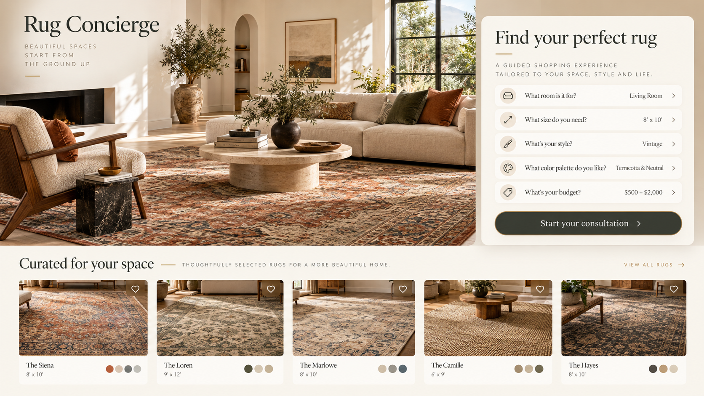

# Rug Concierge

> A full-stack, guided rug-shopping experience that turns a high-consideration home-decor purchase into a thoughtful, conversational recommendation journey.



## The product

Rug Concierge is an e-commerce experience designed around the real questions customers ask before purchasing a rug: **Will it work in my room? What size is right? Does this style fit my space?** The application pairs a polished storefront with a concierge-style guided flow, helping shoppers move from inspiration to a confident, tailored selection.

## What it demonstrates

- **Guided product discovery:** a conversational concierge flow for room, size, style, color, and budget preferences.
- **Customer-first e-commerce UX:** focused browsing, rich rug imagery, product detail, and a persistent shopping journey.
- **Commerce operations:** inventory enrichment, reprocessing and reconciliation scripts, live-intake testing, and attribution checks.
- **Production-minded architecture:** monorepo organization, typed UI, server-aware boundaries, authentication/data clients, rate limiting, and repeatable quality checks.
- **Deliberate design system:** reusable accessible primitives, Tailwind styling, responsive components, and modern interaction patterns.

## Tech stack

| Area | Technologies |
| --- | --- |
| Application | Next.js 16, React 18, TypeScript |
| UI | Tailwind CSS, Radix UI, Lucide |
| Data & platform | Supabase, Upstash Redis + rate limiting |
| Tooling | npm workspaces, Playwright, ESLint |

## Repository structure

```text
rug-concierge/
├── apps/
│   ├── web/        # Customer-facing commerce and concierge application
│   └── site/       # Supporting site experience
├── packages/        # Shared application packages
├── scripts/         # Data-quality, enrichment, and verification tools
└── docs/            # Product and implementation documentation
```

## Local development

Requires Node.js 20.9+ and npm.

```bash
npm install
npm run dev
```

For the supporting site:

```bash
npm run dev:site
```

## Quality checks

```bash
npm run lint
npm run build
npm run check:docs
npm run check:migrations
npm run quality:release
```

## Engineering note

This project intentionally treats the shopping experience as more than a catalog. It combines experience design, customer-intent capture, inventory-quality workflows, and production safeguards to create a more useful commerce product.
