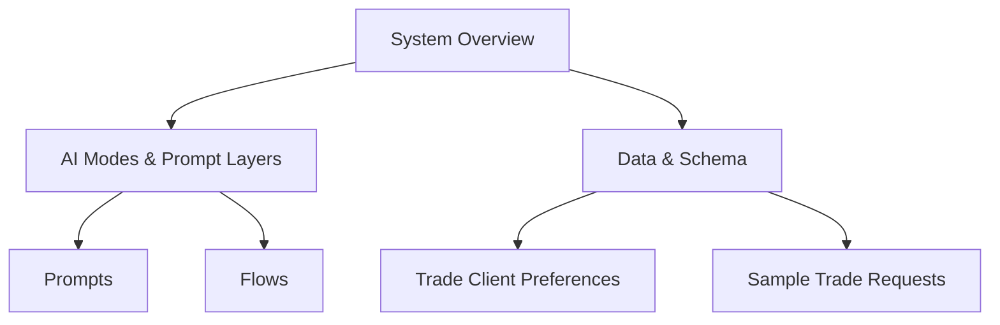

# Documentation

Start here.

## Quick Map

## Architecture
- docs/architecture/overview.md
- docs/architecture/ai-modes.md

## Data & Schema
- docs/data/schema.md
- docs/data/trade-client-preferences.md
- docs/data/sample-trade-requests.md

## Prompts
- docs/prompts/system-prompt.md
- docs/prompts/recommendation-prompt.md
- docs/prompts/recommendation-structured-output.md

## Flows
- docs/flows/concierge/concierge-flow.md
- docs/flows/concierge/lane1-concierge-message.md
- docs/flows/appraisal/appraisal-use-cases.md
- docs/flows/appraisal/lane2-appraisal-message.md

## Glossary
- docs/glossary.md
